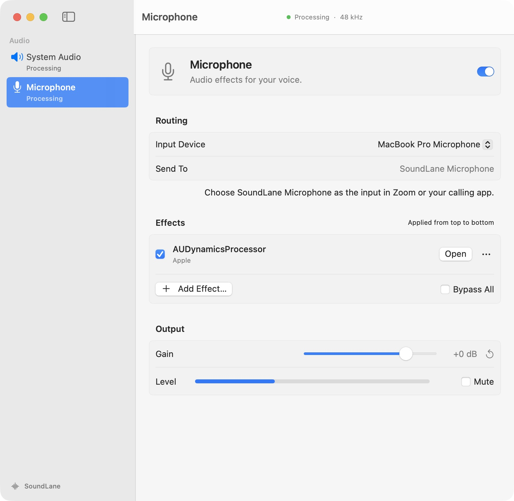

# SoundLane

SoundLane runs two independent Audio Unit effect chains on macOS:

- **System Audio:** audio from your apps → effects → speakers or headphones.
- **Microphone:** your microphone → effects → **SoundLane Microphone**, available as an input in Zoom and other calling apps.

Requires **macOS 14.2 or later on Apple Silicon**. Audio Units are installed separately. No external audio-routing application is required.

[Download SoundLane.dmg](https://github.com/vitalyterenin/soundlane/releases/latest/download/SoundLane.dmg) · [Report an issue](https://github.com/vitalyterenin/soundlane/issues)

## Install

1. Open **SoundLane.dmg**, drag **SoundLane** to **Applications**, and eject the image.
2. Open the installed app. Releases use a persistent self-signed certificate and are not notarized. macOS may require **System Settings → Privacy & Security → Open Anyway** on first launch. Do not install a root certificate or disable security protections.
3. In **Microphone**, use **Set Up…** if the virtual microphone is missing. The included audio component requires administrator authorization once, followed by a Mac restart. The component is installed in `/Library/Audio/Plug-Ins/HAL`; the app itself uses normal drag installation.
4. Choose your devices and turn on the processing switches. Allow microphone and system audio access when macOS requests them.
5. In Zoom, choose **SoundLane Microphone** as the input. Keep your physical speakers or headphones as the output.

The app detects an installed compatible component and does not reinstall it during ordinary app updates. If a future driver version requires an update, **Update Component…** provides the separate authorized installation step.

For the one-time migration from development versions 0.2 and earlier, replace the old installed app with the downloaded signed copy. Those development builds used ad hoc signatures; macOS can require one new privacy grant for the persistent release identity. The old root-owned PKG installation can also require administrator approval once when replacing it. Ordinary drag installations should be owned by the installing user. See [troubleshooting](docs/usage.md#installation-and-permissions).

## Use

Choose **System Audio** or **Microphone** in the sidebar. Both chains can run at once; changing the sidebar selection does not stop either chain.

- Choose **Input Device** or **Output Device** under Routing.
- Use **Add Effect…**, select an Audio Unit, and click **Add Effect**. Effects run from top to bottom.
- Use **Open** for a plug-in's controls. Its options menu moves or removes it; the checkbox enables or bypasses that effect.
- **Bypass All** compares the unprocessed signal with the effect chain. **Gain**, **Reset gain**, and **Mute** control the final output.

Settings preserve devices, effect order, each effect's state and bypass, and gain. Both chains start off at a fresh app launch. Closing the window keeps processing running; the menu bar provides controls. Quitting stops processing. See [usage and limitations](docs/usage.md).

## Updates and privacy

**SoundLane → Check for Updates…** checks manually. **SoundLane → Settings…** controls automatic checks and installation. Sparkle checks every four hours while the app runs by default, with saved choices respected. Normal updates replace the app, not the system audio component. Installation can wait for quit or authorization when the destination is not writable.

Audio stays in the local processing path; SoundLane does not record it or upload it. Update checks and downloads contact GitHub Pages and GitHub Releases. Sparkle system profiling and delta updates are disabled. There is no telemetry. See [privacy](docs/privacy.md).

## Development

See [build and test instructions](docs/development.md), [architecture](docs/architecture.md), [validation](docs/validation.md), and [release operations](docs/releases.md).

Maintained by Vitaly Terenin. The original SoundLane source and application are proprietary; **all rights reserved**. Publishing this repository does not grant an open-source license. [LICENSE](LICENSE) and [third-party notices](THIRD_PARTY_NOTICES.md) describe the applicable terms.
